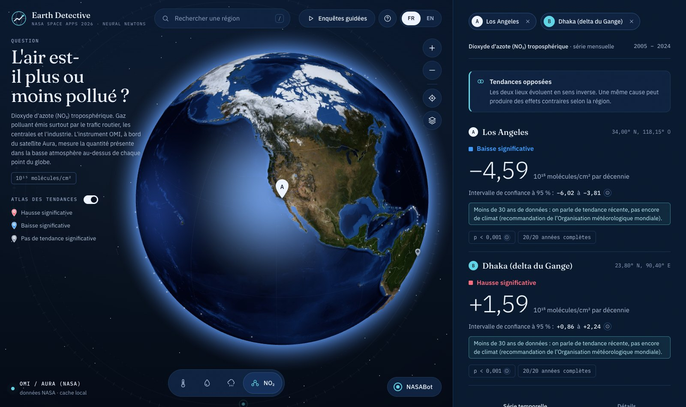

# Earth Detective

**NASA Space Apps Challenge 2026 · défi « Be An Earth System Trend Detective! » · équipe Neural Newtons**

- Site en ligne : **https://earth-detective.onrender.com** (offre gratuite : le premier chargement après une pause prend environ une minute)
- Rapport technique : [docs/Earth_Detective_Technical_Report.pdf](docs/Earth_Detective_Technical_Report.pdf)

Choisis une variable mesurée par la NASA, une région du globe, une période : Earth Detective dit **si ça change, dans
quel sens, de combien, et si ce changement est statistiquement significatif**. Et il montre qu'une même variable peut
monter ici et baisser là-bas.



## Ce que fait l'outil

| Le défi demande | Earth Detective |
|---|---|
| Choisir des variables Earth science | 4 variables de 3 sources NASA : température et humidité (MERRA-2), pluie (GPM IMERG), dioxyde d'azote (OMI). Définitions simples pour chacune. |
| Les obtenir pour une région | 11 régions (villes, Arctique, Sahel, Amazonie…), moyennes de zone calculées par Giovanni / Harmony, mises en cache. |
| Tracer la série temporelle | Série mensuelle en « données brutes » ou « sans les saisons », avec la droite de tendance en option. |
| Dire s'il y a une tendance, de combien, si elle est significative | Test de Mann-Kendall, pente de Sen par décennie, intervalle de confiance à 95 %, contrôles (Hamed et Rao, test saisonnier, régression). |
| Public lycéen et grand public | Verdict en une phrase (« En clair : il fait plus chaud »), avertissement sous 30 ans de données, explication de la p-value. |
| Parcours guidé, démonstrations | 4 enquêtes guidées pas à pas, écrites sans conclusion chiffrée : le verdict vient toujours des données. |
| IA pour suggérer des variables | Trendbot : une question libre (« La pollution baisse-t-elle à Pékin ? ») ouvre la bonne enquête ; fonctionne sans clé d'API. |
| Où ça change | Globe 3D : un repère par région, coloré selon le verdict ; comparaison de deux régions côte à côte. |

## Lancer l'application

Prérequis : Python 3.12 et [uv](https://docs.astral.sh/uv/). Le front est déjà construit (`earth-detective/dist`) et
les données sont dans le dépôt (`data/cache`) : **aucun accès réseau ni identifiant n'est nécessaire pour la démo.**

```bash
uv venv --python 3.12 .venv
uv pip install --python .venv/bin/python -r requirements.txt
PYTHONPATH=src .venv/bin/python app/api.py
```

Puis ouvrir **http://localhost:8000** (documentation de l'API : http://localhost:8000/api/docs).

Variantes :

- `TREND_MOCK=1` : données simulées (développement de l'interface sans le cache).
- App de secours, plus sobre : `PYTHONPATH=src .venv/bin/streamlit run app/streamlit_app.py`.
- Modifier le front : `cd earth-detective && npm install && npm run build`.
- Retélécharger les données NASA : voir `docs/data_choices.md` (identifiants Earthdata requis).

## Déployer (Render, gratuit)

Le fichier `render.yaml` décrit tout le service. Sur render.com : **New → Blueprint**, choisir ce dépôt, valider
(laisser `OPENAI_API_KEY` vide si l'assistant doit tourner sans IA). Chaque push sur `main` redéploie. En offre gratuite,
le site s'endort après 15 minutes sans visite : le premier chargement suivant prend environ une minute.

## Architecture

```
earth-detective/        Front (globe three.js, graphiques d3), servi tel quel par le serveur
app/api.py              Serveur FastAPI : expose le contrat en JSON (catalogue, analyse, atlas, stabilité, assistant)
app/backend.py          Point d'entrée unique vers le moteur (vrai moteur ou mock)
src/trend/              Moteur : catalogue, accès aux données, statistiques, assistant
  schemas.py            Contrat de données partagé (docs/CONTRAT.md)
  sources/giovanni.py   Accès Giovanni : Time Series (point) et Area-Average via Harmony (zone)
  data.py               Lecture du cache, conversions d'unités
  stats.py              Anomalies, Mann-Kendall, pente de Sen, intervalle de confiance
  advisor.py            Suggestions et explications en langage simple, sans clé d'API
data/catalog/           Variables et régions (YAML)
data/demos/             Enquêtes guidées (YAML)
data/cache/             86 séries mensuelles NASA (43 moyennes de zone, 43 points)
scripts/build_cache.py  Précalcul du cache depuis Giovanni
tests/                  38 tests (moteur, données, assistant, serveur)
docs/AGENT.md           Où et comment brancher l'agent IA
```

Règle de conception : **aucun chiffre affiché ne vient d'ailleurs que du moteur statistique**, et l'application
fonctionne sans réseau.

## Vérifier

```bash
PYTHONPATH=src:app .venv/bin/python -m pytest -q
.venv/bin/ruff check src app scripts tests
```

## Documentation

- `docs/CONTRAT.md` : contrat entre les parties (structures de données, fonctions, catalogue).
- `docs/DECISIONS_DONNEES.md` : pourquoi ces variables et ces régions.
- `docs/data_choices.md` : chaîne de traitement des données et tableau des tendances.
- `docs/methods.md` : méthode statistique, limites et références.
- `docs/AUDIT.md` : état du projet, choix de finition, risques connus.
- `docs/AGENT.md` : interface à respecter pour brancher l'agent IA.

## Use of AI

- Development: the team used AI coding assistants (including Claude Code) to help write and review parts of the Python and JavaScript code, the documentation and the data-access scripts. All code was reviewed and tested by the team (38 automated tests).
- In the product: Trendbot can use the OpenAI API (gpt-4.1-mini by default) to map a free-text question to a variable and region from our catalogue and to rephrase computed results in plain language. It never computes statistics: every number shown comes from our statistics engine, and AI answers containing unverified numbers are rejected automatically. Without an API key, Trendbot answers with rules.
- No images, video or audio were generated with AI. Globe imagery is NASA Blue Marble.

## Données et crédits

Données NASA : MERRA-2 (GMAO), GPM IMERG V07, OMI/Aura OMNO2d, via Giovanni et Harmony (GES DISC).
Image de la Terre : NASA Blue Marble. Pas de logo NASA (règles Space Apps).
